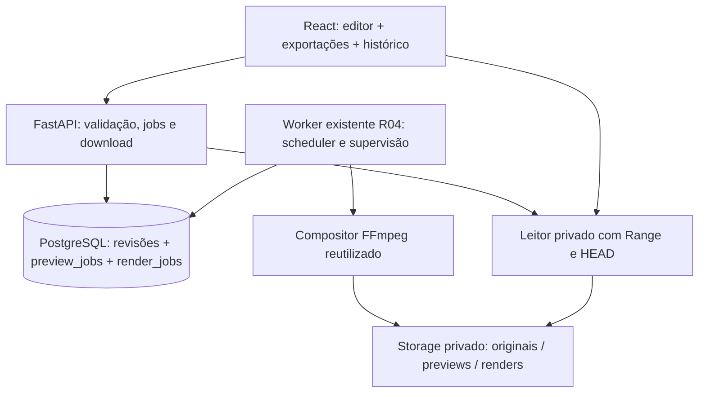

# Edivo — R05 | Especificação operacional: Renderização, Exportação e Histórico

**Data da especificação:** 21/10/2026  
**Produto:** Edivo — Editor de vídeos com IA, com fluxo futuro orientado principalmente por prompts  
**Repositório:** `edivo-editor` (`davioliveiraes/edivo-editor`)  
**Status:** **proposta operacional para aprovação; NÃO autoriza implementação, migração, modificações em containers nem operações de Git**.  
**Etapas anteriores:** R01–R03 verificadas em documentos/código publicados; R04 concluída e validada **conforme relatório do usuário** (700 casos backend distintos, 149 frontend, 17/17 critérios).  
**Continuidade aprovada:** R05 exportação; R06 robustez/QA; R07 integração isolada do heditor da PycodeBr; R08 experiência de prompts e agente; R09 pesquisa Higgsfield. **Sem IA na R05.**

> **Limite de auditoria essencial:** O ambiente WSL `~/edivo-editor` do usuário não está montado neste ambiente de trabalho. A branch `main` do GitHub estava publicada até a R03 na última consulta; os arquivos `docs/r04/acceptance.md`, `docs/r04/qa-results.json`, `backend/alembic/versions/0004_r04_text_audio_previews.py` e os módulos R04 não puderam ser consultados diretamente. Esta especificação é fundamentada nos contratos publicados da R03, na especificação R04 aprovada, e nas informações de R04 reportadas pelo usuário, **não** em uma auditoria independente do código local R04. O primeiro gate da eventual implementação será a **auditoria obrigatória R05.0 do checkout local**, com verificação de nomes, schemas, tabelas, transições e semântica reais. As decisões novas abaixo são **propostas**, não comportamentos observados.

## 1. Visão de produto e fronteira da R05

A R05 transforma as composições não destrutivas já salváveis e pré-visualizáveis no Edivo em **vídeos MP4 finais, completos e baixáveis**, com operação assíncrona, acompanhamento, cancelamento e histórico por projeto. A exportação é calculada a partir de uma **revisão imutável** do EditSpec e nunca modifica vídeo/áudio originais nem prévias anteriores.

**Definição de pronto, vista pelo usuário:** abrir um projeto, concluir uma edição, salvá-la, escolher o perfil de qualidade, solicitar renderização do trecho completo, acompanhar o processamento, cancelar se necessário, reproduzir e baixar o MP4 final, consultar os resultados anteriores após reiniciar serviços, identificar a revisão que produziu cada resultado e verificar que originais e prévias continuam íntegros.

**Inclui:**

1. Render completo do `trim` definido na revisão salva, com vídeo H.264, textos, canvas, áudio fonte, MP3 opcional, volumes/loop/fades da R04.
2. Modelo persistente de `RenderJob`, processamento assíncrono no **worker existente**, idempotência, leases, heartbeat, fencing, recuperação e cancelamento.
3. Perfil de exportação e metadados do arquivo final; checksum e validação completa antes de disponibilização.
4. API de solicitar/listar/consultar/cancelar render e ler/baixar MP4 por rota privada com HTTP Range/HEAD.
5. Interface React de exportação, estado/progresso fundamentados, histórico por projeto e download.
6. Orçamento de recursos, políticas conservadoras de armazenamento, regressões R01–R04 e QA com FFmpeg real.

**Não inclui:** heditor, campo de prompt, LLM/agentes, integrações externas, Higgsfield, transcrição, legendas automáticas, motion graphics GSAP, multitrilha, transições, keyframes, fila distribuída, notificações externas, login/SaaS, exportação em nuvem, resolução 4K, novos codecs ou mudança dos originais. Não substituir, refatorar em massa nem reconstruir o pipeline R04 por um segundo motor.

## 2. Matriz de contratos: constatado, relatado e a confirmar

| Contrato | Base de evidência | Tratamento na R05 |
|---|---|---|
| `Project`, `MediaAsset`, isolamento por projeto, soft delete e originais `0400` | Código/documentação R02/R03 publicados | Preservar; nunca servir caminhos físicos. |
| `EditSpecRevision` append-only, numeração, `expected_revision`, conflitos 409 e no-op | Código/QA R03 publicados | Reutilizar; render aponta para UUID de uma revisão salva específica. |
| `EditSpec v1`: fonte, trim, canvas | Schema R03 publicado | Exportar v1 diretamente com defaults neutros, sem migrar registros. |
| `EditSpec v2`: até 3 textos, áudio, um MP3, loop, fades | Especificação R04 aprovada + conclusão reportada | Conferir payload/modelos reais locais; exportar v2 sem reformular semântica. |
| `AudioAsset` separado do `MediaAsset`, MP3/600 s/30 MiB e original `0400` | Especificação R04 + reporte | Reutilizar storage e validações; nenhuma reimportação. |
| `PreviewJob` em PostgreSQL, lease/heartbeat/fencing, máximo 2 tentativas | Especificação R04 + reporte | Inspecionar implementação real e **reutilizar** protocolo; nunca presumir nome interno ou equivalência de tokens. |
| Compositor FFmpeg real H.264/AAC e preview <=8s; GET/HEAD Range privados | Especificação R04 + reporte | Extrair/reutilizar planejamento de filtros e validação; evitar mudança no comportamento R04. |
| Worker separado com fila PG e recuperação | Reportado para R04; ainda não disponível na branch examinada | Reutilizar loop/executor/supervisão após auditoria local. |
| QA R04: 700 backend; 149 frontend; 25 prévias; 43 checks FFmpeg; 83 MP4/6 MP3/5 prévias | Relatório do usuário de 21/10/2026 | Referências históricas, **não** resultados verificados aqui nem metas artificiais. |

### R05.0 — gate local obrigatório antes de implementação

Ler no checkout local: `AGENTS.md`, README, documentação R00–R04, `docs/r04/{acceptance.md,qa-results.json,compatibility.md}`, migration `0004`, modelos/schemas/repositórios/services de `PreviewJob` e `AudioAsset`, API de preview, worker, compositor, leitor privado de storage, cliente React, testes e configuração Compose. Gerar `docs/r05/compatibility.md` **antes de escrever código**, comparando os contratos reais com esta proposta. Registrar: nomes de campos, modelos, PK/FK, estados, limites, reentrância/leases/fencing, logging de progresso, assinatura do compositor, FFmpeg/FFprobe efetivos, convenções de revisão, idempotência, cache, path seguro, layout e dependências.

Se divergir algo essencial, ajustar a proposta em documentação **antes** da implementação com justificativa e aprovação do usuário quando envolver mudança de contrato relevante, mutação destrutiva, originais ou risco de dados. **Não inventar compatibilidade.** Não executar testes ou modificar serviços ObraControl para investigar a R05.

## 3. Arquitetura alvo (reutilização, não duplicação)



- **API:** cria e consulta jobs em transações curtas; não executa codificação por requisição HTTP, `BackgroundTasks` ou tarefa volátil.
- **Worker:** agenda **previews e exports** reutilizando infraestrutura R04; por padrão um subprocesso FFmpeg ativo por worker; múltiplos processos worker, se testados, exigem limites globais/coordenados e fencing.
- **Composer:** separação entre `EditSpec` imutável, normalização/planejamento de timeline/áudio/texto, gerador seguro de filtergraph, perfil de saída e execução/validação FFmpeg. O mesmo núcleo deve gerar preview curto e render completo, com diferenças explícitas de janela/qualidade.
- **Storage:** originais `0400` e media/audio intocados; diretórios privados, temporários isolados por job, publicação atômica/no-replace de `renders/{project_uuid}/{job_uuid}/final.mp4` (caminho apenas ilustrativo, confirmar convenções R04), artefato só legível via gate de API.
- **Front:** controles de exportação e histórico dentro do fluxo React existente, sem outro player/editor paralelo nem alteração de navegação desnecessária.

## 4. Banco — migration incremental `0005_r05_render_exports`

Criar migration descendente da revisão real R04 **após confirmar o identificador** `0004_r04_text_audio_previews`. **Não** reescrever 0001–0004, editar dados antigos ou fazer downgrade destrutivo. Criar `render_jobs` como entidade de exportação; uma tabela separada `exports` só se a auditoria justificar necessidade funcional clara. O histórico pode ser consultado da tabela de renderizações concluídas/terminadas.

### Campos propostos `RenderJob`

| Campo | Papel / constraint |
|---|---|
| `id` UUID PK | Identificador gerado no servidor. |
| `project_id` UUID FK RESTRICT | Projeto proprietário. |
| `edit_spec_revision_id` UUID FK RESTRICT | **Revisão imutável exata**. |
| `revision_number` | Pode ser derivado da relação (evitar duplicação se não necessário). |
| `profile` | Token tipado `standard` ou `high`; sem CLI livre. |
| `preset` | Proporção derivada do snapshot, não livre no job. |
| `status` | `queued`, `running`, `completed`, `failed`, `canceled`. |
| `stage` | `preparing`, `encoding`, `validating`, `publishing` quando efetivamente conhecido. |
| `attempts`, `max_attempts` | Limite de tentativas; respeitar R04 e permitir ajuste documentado. |
| `lease_expires_at`, `heartbeat_at` | Supervisão da execução. |
| `lease_token` ou `fencing_token` | Identifica tentativa autorizada a publicar; nunca reaproveitar token vencido. |
| `cancel_requested_at` | Cancelamento solicitado de forma durável. |
| `progress_encoded_ms` ou equivalente | Avanço real validado da codificação, monotônico por tentativa. |
| `idempotency_key` e `request_fingerprint` | Evitam duplicação e conflito com parâmetros divergentes. |
| `render_engine_version` | Versão interna do compositor/perfil/FFmpeg necessária para rastreabilidade. |
| `artifact_storage_key` | **Interna**, somente preenchida após promoção segura. |
| `artifact_sha256`, `artifact_byte_size` | Verificação da saída real. |
| `artifact_duration_ms`, `width`, `height`, `video_codec`, `audio_codec` | Metadados da saída, quando concluída. |
| `error_code` | Código controlado, sem logs técnicos no JSON público. |
| `created_at`, `started_at`, `finished_at`, `updated_at` | UTC, com semânticas explícitas. |

Constraints/índices: FKs RESTRICT; enums/checks para status/perfil; bytes e duração positivos quando concluído; artefato obrigatório e coerente para `completed`, ausente para demais; índices `(project_id, created_at DESC, id DESC)`, `(status, created_at)`, lease expirada e idempotência por projeto. Campos de job mutáveis somente por **máquina de estados autorizada**, ao contrário de `EditSpecRevision` append-only.

### Estados e transições (contrato de referência)

```text
queued -> running -> completed
    |        |-> failed
    |        |-> canceled
    |-> canceled

running (lease expirada) -> queued (retry elegível) ou failed
```

Cancelamento solicitado a `running` primeiro marca `cancel_requested_at`; `canceled` só após worker reconhecer/terminar o processo ou reconciliação comprovada. Estados terminais `completed`, `failed`, `canceled` não reabrem. Jobs de retry são novas tentativas rastreáveis, não resultados inventados. Falha/cancelamento nunca publicam artefatos como válidos.

### Compatibilidade e migração

- EditSpec v1/v2, `preview_jobs`, `audio_assets`, `media_assets`, `projects` e respectivos dados/triggers/índices continuam intactos.
- Migração repetível `upgrade head` e `alembic check` sem deriva; migrations históricas não modificadas.
- Snapshot anterior/depois de registros originais e hashes; sem recodificar arquivos preexistentes.
- Não inferir automaticamente permissões de exportação a partir de campos do banco; validar projeto ativo na API.

## 5. Identidade da renderização, idempotência e vínculo à revisão

**Entrada de um job:** `project_id`, `edit_spec_revision_id` (UUID existente e pertencente ao projeto), `profile`, `idempotency_key` opcional gerada no cliente. A **duração renderizada** é exatamente o trim salvo completo (não a janela de preview). Não permitir fonte/áudio/canvas/textos ou FFmpeg args enviados avulsamente pelo endpoint render.

- Verificar revisão e seus arquivos de origem no projeto ativo antes de aceitar; a revisão é sempre a fonte da verdade, inclusive para exports históricos.
- Chave do resultado deriva de `(project_id, revision_id, profile, versão do compositor/perfil e parâmetros relevantes)` com validação adicional da integridade do artefato antes de reutilização; persistir fingerprint controlada. Preferir reaproveitar job equivalente queued/running e artefato completed **íntegro**; não reutilizar arquivo ausente, corrompido, de revisão diferente ou gerado sob versão incompatível.
- `idempotency_key` igual + payload igual retorna o mesmo job; igual + payload diferente retorna `409 idempotency_conflict`. Escopo por projeto. Após `failed`/`canceled`, permitir novo pedido explícito com nova chave/tentativa sem alterar resultado histórico.
- Se um usuário editar novamente o projeto durante render, o job mantém sua revisão original; a UI deve identificar se o resultado já não representa a revisão atual. Exportar não altera a edição nem a numeração.
- Limite padrão sugerido de **1 render ativo por projeto**; impedir acumular fila ilimitada, principalmente se o worker estiver offline. Confirmar limites reais R04/Compose e documentar concorrência entre previews e renders.

## 6. API REST R05 — proposta (nomes novos, preservar R01–R04)

Namespace `/api/v1/projects/{project_id}`:

| Método | Endpoint | Sucesso | Observações |
|---|---|---|---|
| `POST` | `/renders` | `202` job enfileirado/em processamento; `200` reaproveitamento concluído | Requer revisão salva, perfil tipado e idempotência. |
| `GET` | `/renders?limit=20&offset=0` | `200` `{items,total,limit,offset}` | Histórico paginado ordenado `created_at DESC, id DESC`; filtro status opcional controlado. |
| `GET` | `/renders/{render_id}` | `200` metadados/status | Nunca expor storage keys, argv FFmpeg, paths ou secrets. |
| `POST` | `/renders/{render_id}/cancel` | `202` quando ainda precisa confirmar término; `200` se já cancelado | `409` para job já concluído/falhado; sem matar processo direto na API. |
| `GET` | `/renders/{render_id}/file` | `200` ou `206` MP4 exportado | Apenas artefato `completed` íntegro e projeto ativo; download privado. |
| `HEAD` | `/renders/{render_id}/file` | Headers equivalentes, corpo ausente | Range/HEAD consistentes com a R03/R04. |

**Exemplo de `POST /renders`** (UUIDs ilustrativos):

```json
{
  "edit_spec_revision_id": "11111111-1111-4111-8111-111111111111",
  "profile": "standard",
  "idempotency_key": "22222222-2222-4222-8222-222222222222"
}
```

**Exemplo de resposta de acompanhamento** (estrutura proposta, não implementada):

```json
{
  "id": "33333333-3333-4333-8333-333333333333",
  "project_id": "44444444-4444-4444-8444-444444444444",
  "edit_spec_revision_id": "11111111-1111-4111-8111-111111111111",
  "revision_number": 8,
  "profile": "standard",
  "status": "running",
  "stage": "encoding",
  "progress_percent": 37,
  "artifact_available": false,
  "created_at": "2026-10-21T20:00:00Z",
  "started_at": "2026-10-21T20:00:10Z",
  "finished_at": null,
  "error_code": null
}
```

**Regras HTTP:** `404` para projeto/job ausente, excluído ou de outro projeto; `409` para revisão conflitante/estado não cancelável, arquivo ainda não disponível, chave idempotente divergente; `422` entradas inválidas; `429` ou `409` para limite de jobs ativos, conforme padrão existente e documentado; `503` dependência/storage indisponível; erros `500` sanitizados. Formato R01 `{code,message,request_id}` com `X-Request-ID` preservado. Não usar `Content-Length` inteiro carregando arquivo em memória. Evitar sucesso fictício antes de validar a mídia.

**Download privado:** reusar leitor por descritor seguro, proteção contra symlinks/traversal e `GET/HEAD` com Range fechado/aberto/suffix e `200/206/416`; `Content-Type: video/mp4`, `Accept-Ranges`, `Content-Length` e `Content-Range` corretos, `Cache-Control: private, no-store`, `X-Content-Type-Options: nosniff`, `Content-Disposition: attachment` com filename **gerado e saneado no servidor** (p. ex. `edivo-r8-9x16-standard.mp4`, sem interpolar filename de usuário). `Content-Range: bytes */total` em 416, corpo vazio em HEAD. Não servir storage estático nem fornecer URL pública genérica. O navegador pode usar sua reprodução de preview R04, enquanto downloads finais permanecem anexos privados.

## 7. Perfis de saída final propostos (R05)

Resoluções finais em pixels quadrados, H.264 (`libx264`) `yuv420p`, MP4 com `+faststart`, áudio AAC quando houver, `48 kHz` com layout stereo se pertinente e `setsar=1`. A ausência de áudio original/MP3 não impede saída sem stream de áudio. **Nada de redimensionar/esticar a fonte incorretamente:** usar a composição `canvas.fit`/focal, respeitando orientação, SAR, matrizes de rotação, PTS e VFR.

| `canvas.preset` | Saída final proposta |
|---|---|
| `9:16` | `1080 × 1920` |
| `1:1` | `1080 × 1080` |
| `4:5` | `1080 × 1350` |
| `16:9` | `1920 × 1080` |

Perfis controlados (valores iniciais **a validar no runtime R05.0**):

- `standard`: `libx264 -preset veryfast -crf 23`, FPS de saída constante 30 fps, AAC 160 kb/s se houver áudio.
- `high`: `libx264 -preset medium -crf 20`, 30 fps, AAC 192 kb/s se houver áudio.
- Ambos: `yuv420p`, `+faststart`, mesma proporção, sem prometer bitrate/tamanho final exato. FPS e políticas de resampling deverão ser medidos; caso a máquina não sustente `high` em prazo aceitável, documentar e ajustar **antes** da implementação autorizada. Não fornecer parâmetros arbitrários FFmpeg para o frontend.

**Duração:** o render processa `[trim.start_ms, trim.end_ms]` por completo, limitado às mídias aceitas na R02 (padrão até 600s) e aos limites adicionais configurados; a duração resultante pode variar por quantização de frames/amostras, dentro de tolerância medida e documentada, nunca por truncamento silencioso. Textos usam tempos absolutos da fonte; música inicia em `trim.start_ms` e fades se aplicam ao trim inteiro. A R05 **não** pode apenas concatenar arquivos de prévia de 8s: precisa compor o intervalo completo a partir do EditSpec salvo e dos originais.

**Áudio:** mix do áudio fonte conforme `source_volume` (0–2), música opcional (0–1), loop, fades em 0–3000ms de acordo com a semântica R04. Verificar headroom/clipping e inteligibilidade; FFprobe/medidas automáticas não substituem escuta humana. Se suporte codec nativo for insuficiente, job falha com código seguro, não exporta MP4 incompleto.

**Texto:** até 3 overlays da R04, styles tokens e safe area 7%, fontes aprovadas locais e arquivo UTF-8 privado; filtros escapados sem inserir HTML/expressões arbitrárias. Paridade temporal/visual entre player CSS, prévia R04 e saída final dentro de tolerâncias documentadas.

**Configuração preliminar:** `EDIVO_RENDER_TIMEOUT_SECONDS=3600` (60min), `EDIVO_RENDER_MAX_OUTPUT_BYTES=2147483648` (2GiB), `EDIVO_RENDER_MAX_ACTIVE_PER_PROJECT=1`, `EDIVO_RENDER_WORKER_CONCURRENCY=1`, `EDIVO_RENDER_POLL_SECONDS=2`; todos configuráveis com limites saneados. Confirmar compatibilidade/nomes e estratégia de recursos com `.env.example` e Compose R04. Política de reserva/estimativa de espaço deve considerar arquivos temporários e cópia final, sem garantia fictícia de tamanho. Evitar usar 500MiB (limite de upload) como teto do resultado.

## 8. Núcleo FFmpeg, progresso medido e validação

**Pipeline:** ler snapshot e hashes de mídia/áudio pelo storage seguro; construir plano de composição tipado; configurar linha de comando com allowlist e argv, `shell=False`, sem stdin (`-nostdin`), definir threads/CPU/memória/I/O conforme capacidades do container; criar workspace restrito por `(job_id,attempt_token)`; gerar saída temporária; validar; promover por operação **no-replace**; atualizar metadados concluídos apenas se token/lease ainda válido e cancelamento não solicitado.

**Progresso real:** preferir `-progress pipe:1` com `-stats_period` e parser limitado; registrar `out_time_us`/campos realmente presentes no FFmpeg local. Cuidado: campos como `out_time_ms` podem representar microssegundos em versões FFmpeg; **não presumir unidade a partir do sufixo sem teste real**. Computar avanço com base no tempo processado do intervalo de render, arredondar de maneira monotônica e limitar interface a **99%** enquanto codificação/validação/publicação não terminarem. `100%` e `completed` só após decodificação, checks e commit exitoso; estágios `validating` e `publishing` não prometem duração percentual. Não enfileirar/armazenar stdout/stderr indefinidamente e não retornar logs crus ao frontend. Referência: https://ffmpeg.org/ffmpeg.html

**Validação integral obrigatória antes de publicar:** FFprobe de container/streams/resolução/SAR/FPS/codecs/duração, `ffmpeg -f null -` para decodificação completa (ou equivalente seguro), tamanho, SHA-256, modo/ownership, áudio presente/ausente coerente, tolerância temporal medida, `moov` otimizado quando viável, e verificação do artefato na rota privada. Usar amostra renderizada para checagem objetiva de texto/crop/rotação; QA auditivo humano para perfis e mix representativos quando possível. Não marcar `completed` após apenas `ffmpeg returncode=0`.

**Falhas:** timeout, sem espaço, source MP4 corrompida além do prefixo verificado na R02, fonte ausente, FFmpeg indisponível, filtro inválido, falha de publish/commit, cancelamento, perda de lease; cada caso possui erro/estado sanitizado. Respeitar reserva do disco e não deletar originais, MP3 ou prévias; compensar somente temporários/artefatos próprios cuja propriedade está comprovada. Se COMMIT final for incerto, preservar artefato para reconciliação, **nunca** anunciá-lo como disponível sem estado persistido coerente.

## 9. Scheduler/worker, cancelamento, crash e segurança de concorrência

**Reutilizar** o worker R04, fila PG, heartbeat, fencing e gestão do processo FFmpeg. Se módulos do compositor estiverem acoplados exclusivamente a previews, extrair função reutilizável **sem regressão da R04**, com testes dourados de outputs previamente aceitos.

- Claim de render via transação curta com `FOR UPDATE SKIP LOCKED`, respeitando lease e limite por projeto; commit antes de iniciar subprocesso. Implementar política simples para coexistir com previews sem starvation evidente (p. ex. FIFO entre tarefas elegíveis, com preferência limitada por previews), documentando a ausência de preempção de render em andamento. Um worker não deve acionar dois FFmpeg ativos se a concorrência configurada é 1.
- Renovar heartbeat/lease enquanto render ocorre; fencing impede tentativa antiga de concluir/publicar quando lease foi transferida. Em colisão, o perdedor para o processo e descarta apenas seu workspace.
- Cancelamento `queued`: atualizar para `canceled` atomicamente sem iniciar FFmpeg. Cancelamento `running`: persistir intenção, supervisor observar rapidamente, enviar sinal controlado ao grupo de processo **próprio** (SIGTERM, grace configurável, SIGKILL apenas se necessário), aguardar término, limpar staging e finalizar estado. A requisição HTTP **não** envia sinais ao SO. SIGTERM do container deve encerrar ou supervisionar corretamente processos descendentes; testar worker parado brutalmente e possíveis órfãos.
- Após crash/lease expirada: reconciliação determina se deve recuperar, fazer retry dentro do máximo ou marcar `failed`/`canceled`; jobs cancelados **nunca** voltam a `queued`. Workers múltiplos não podem publicar a mesma saída. Não apagar artefatos desconhecidos ou provenientes de outros jobs.
- **Cancelamento x conclusão:** se solicitação de cancelamento for gravada antes do commit de conclusão, conclusão deve ser bloqueada. Se o job já estiver completo, responder conflito/estado final, não alegar que foi cancelado. Testar essa fronteira com transações concorrentes.
- Retries explícitos após terminal falho/cancelado criam solicitação própria, não apagam histórico; tentativas internas respeitam o limite informado. Não usar retries infinitos.
- Segurança: nunca executar `shell=True`; source é `storage_key` validada, não arquivo remoto ou path arbitrário; arquivos em workspace 0700 e temporários no mesmo filesystem de promoção; logs sem segredos, textos privados ou argv completo. Respeitar usuário não-root e `no-new-privileges` existentes.

## 10. Interface React — exportação e histórico

Preservar o editor existente `#/projects/{uuid}/editor` e navegação por hash. Adicionar seção ou painel **Exportar vídeo** sem criar outro editor nem substituir prévias R04. UX em português, responsiva e acessível:

1. Selecionar `standard` ou `high` e apresentar dimensões calculadas do `canvas.preset` da revisão, codec H.264/AAC, formato MP4 e aviso de que render completo pode demorar conforme máquina/duração. Sem estimativas de minutos inventadas.
2. Se draft está alterado/dirty, orientar **Salvar edição** antes de exportar; não salvar automaticamente. Solicitação aponta para `edit_spec_revision_id` atual e mostra número/UUID curto para rastrear a origem do resultado.
3. Mostrar estados **Na fila**, **Renderizando**, **Validando**, **Concluído**, **Falhou**, **Cancelamento solicitado**, **Cancelado**. Progresso baseado em dados persistidos do worker; mostrar indeterminado quando não houver medição válida, sem 100% antecipado.
4. Botão **Cancelar renderização** funcional apenas para queued/running e confirmado; atualizar resultado após resposta e polling. Não prometer cancelamento instantâneo nem deixar botão enganoso.
5. Ao completar, apresentar metadados reais e botão **Baixar MP4**, usando endpoint privado. Informar revisão, perfil, resolução, duração, bytes, data e status. O navegador recebe filename seguro via headers.
6. Histórico por projeto com paginação e diferenciação `completed/failed/canceled`, indicação de exports de revisões anteriores, opção de consultar o motivo amigável de erro e repetir uma operação falha com nova requisição autorizada. Sem excluir/reprocessar automaticamente arquivos de usuários.
7. Recuperar jobs e histórico após reload/restart; polling moderado (por exemplo 2s somente enquanto ativo), AbortController e cleanup na navegação. Evitar perda de job caso a página seja fechada.
8. Preservar player, timeline, trim, texts, MP3, previews R04, tema claro/escuro, teclado, toque emulado e telas 375/390px; botão de download deve ser acessível sem copiar URL interna.

Não expor progressos simulados, áreas de prompts ou botões sem comportamento. Se o backend estiver offline, mostrar estado real e permitir atualizar após recuperação.

## 11. Política de armazenamento, retenção e auditoria

A R04 reportou 83 MP4 originais, 6 MP3 e 5 prévias, sem artefatos desconhecidos. **Essas quantidades são apenas baseline reportada**, a ser auditada localmente no gate R05.0 e ao concluir R05; novos exports não devem alterar hashes/modos dos originais. Backups não são substituídos por `0400`.

- Exportações finais devem permanecer disponíveis por padrão; **sem limpeza automática destrutiva** na R05. Não apagar previews/originais existentes, inclusive de projetos soft-deleted, nem volumes; não executar `docker compose down -v`.
- Implementar monitoramento/diagnóstico **somente leitura** de espaço, totais de artifacts por tipo e arquivos potencialmente órfãos; disponibilizar em documentação/QA. Em disco insuficiente, rejeitar/pausar nova execução com erro seguro, em vez de limpar arquivos de usuário.
- Uma política futura de retenção pode definir remoção explícita e auditada de resultados derivados, com marcação persistente e confirmação; isso não está automaticamente autorizado por esta especificação. Se a implementação R05 exigir limpeza física, apresentá-la separadamente para autorização antes de codificar exclusões.
- Arquivos incompletos de tentativas atuais podem ser limpos pelo próprio job com conferência inequívoca de ownership. Um job terminal não deve deixar `temp`/workspaces próprios; falhas crash precisam de auditoria e recuperação segura, sem tratar arquivo desconhecido como lixo.
- Descoberta/reconciliação de artefatos entre PostgreSQL/filesystem (queda entre publish e COMMIT) deve ser read-only por padrão e preservadora de dados.
- Acesso protegido por projeto ativo; soft delete impede downloads sem apagar histórico/binários.

## 12. QA técnico e de produto

### Backend, API, banco e segurança

- Migration 0005 repetível; `alembic current`/`check` válidos; históricos v1/v2, triggers, hashes originais, preview jobs, áudio e regressões preservados.
- Render de revisão v1 e v2, revisão antiga, no-op, 409 de save, source MP4 ou MP3 incorreto/inexistente, projeto soft-deleted, job de outro projeto, payload extra, invalid profile/idempotência divergente.
- Deduplicação por fingerprint, concorrência real de POST, perfis different, re-render após fail/cancel; limite ativo e banco offline; corrida de cancelamento vs conclusão, cancel queued/running/terminal; fuga de lease, retry, timeout, SIGTERM e SIGKILL de worker, dois workers elegíveis, sem publicação duplicada.
- API `POST/GET list/GET detail/POST cancel/GET HEAD file`: validações status/cabeçalhos/error envelope, Range completo/aberto/suffix/416, bytes exatos, Content-Disposition download, leitura contínua de arquivo grande sem RAM proporcional, symlinks/path traversal, descritores fechados.
- Teste com falta de espaço/storage/FFmpeg, falha de hash/decodificação/publish/DB commit, cleanup e reconciliação conservadora.
- Proibir render de draft dirty via frontend; API exige revisão salva (não depende do estado do navegador).

### FFmpeg e mídia real

- Fixtures sintéticas com vídeo horizontal/vertical/quadrado, sem áudio/com áudio, VFR, rotação, SAR e textos Unicode; testar trim que não começa em zero e fade no início/fim do trim completo; MP3 curto com/sem loop, música baixa + fala sintética, fonte sem áudio; quatro canvases, cover/contain/focal.
- Render integral de **duração maior que 8s** (ex. 12–30s) para provar que não é preview, usando filtros de texto, áudio e resolução final; comparação com preview de mesma revisão e janela dentro das tolerâncias.
- `ffprobe`+full-decode em todos os exemplos reais, frame checks de texto/crop e orientação; verificar canais/amostras e ausência de clipping grosseiro. **Escuta humana** por pessoa identificada ou registrar explicitamente pendência; análises automatizadas não equivalem a escuta.
- Medir FFmpeg `-progress`/unidades reais no runtime instalado, percentuais não regressivos por tentativa e 100% somente após validação. Simular cancel durante encoding e terminal não válido. Testar limite de duração de 600s por validação e, se viável, benchmark físico de arquivo longo sem prejudicar recursos; **não** declarar teste 600s se não executado.

### Frontend e navegador

- Vitest RTL para criação, histórica, polling, retry, cancelamento, progresso, erro, export stale revision, save-first, botão de download, estados de offline e tema/responsivo.
- Chromium real end-to-end: importar MP4/MP3 sintéticos, salvar EditSpec v2 com texto e áudio, renderizar >8s, acompanhar progresso real, obter arquivo e baixar, confirmar MP4 e stream de preview, cancelar uma segunda exportação, recuperar histórico após reinício, confirmar R01–R04 ativos.
- Registrar QA de export em Chromium e, se possível, navegador adicional/dispositivo físico, sem alegar testes não realizados. Testar mobile emulado 375/390px; dispositivos físicos somente se efetivamente disponíveis.
- Executar `pytest`, Ruff, Vitest (reter logs completos de falha intermitente), ESLint, Prettier, TypeScript, Vite, Compose config/build/up, Alembic, FFmpeg/FFprobe, regressões R01–R04, HTTP real, browser e auditoria antes/depois. **700 backend e 149 frontend são contagens R04 reportadas, não números a reproduzir artificialmente.**

### Critérios de aceite (não marcar antes da implementação)

- [ ] **01.** Gate R05.0 documentou os contratos locais reais da R04, divergências e baseline antes de alterações.
- [ ] **02.** APIs e comportamentos R01–R04 passaram regressões, incluindo previews, EditSpec v1/v2, 409, upload e streaming.
- [ ] **03.** Migration 0005 é incremental/repetível e não altera dados históricos.
- [ ] **04.** `RenderJob` persiste status, perfil, revisão e histórico, com índices, FKs e limites.
- [ ] **05.** Render usa uma revisão imutável salva; dirty draft não é exportado implicitamente.
- [ ] **06.** Quatro presets finais produzem as resoluções definidas e H.264 `yuv420p` / AAC quando aplicável.
- [ ] **07.** Render completo superior a 8 segundos prova pipeline independente da janela preview.
- [ ] **08.** Textos, crop, focal, trim, volumes, música, loop e fades batem com EditSpec e tolerâncias documentadas.
- [ ] **09.** Worker reutiliza scheduler/compositor R04 sem duplicar motor ou quebrar previews.
- [ ] **10.** Progresso real é demonstrado e 100% só após validação/publicação.
- [ ] **11.** Cancelamento queued/running, corrida com conclusão, retry/lease/fencing e crash são testados.
- [ ] **12.** Requisições idempotentes não criam resultados duplicados indevidamente.
- [ ] **13.** MP4 final é inteiramente validado (FFprobe, full-decode, SHA-256, bytes) antes de `completed`.
- [ ] **14.** GET/HEAD de download privados respondem HTTP Range 200/206/416 com headers corretos.
- [ ] **15.** Histórico paginado mostra revisão, status, perfil e arquivos de forma consistente após restart.
- [ ] **16.** Interface exporta, acompanha, cancela, baixa e recupera jobs reais, inclusive mobile/teclado/temas.
- [ ] **17.** Erros não vazam caminhos/logs/segredos e arquivos não concluídos não são servidos.
- [ ] **18.** Originais MP4/MP3, revisões imutáveis e prévias anteriores permanecem íntegros; nenhum desconhecido excluído.
- [ ] **19.** Testes automatizados, FFmpeg real e navegador possuem contagens/comandos/evidências verificáveis; ocorrência Vitest R04 monitorada.
- [ ] **20.** ObraControl/portas/volumes/locks preservados; Git permaneceu sob gestão manual.
- [ ] **21.** Documentação R05/QA, limitações e estado real dos recursos foram atualizados.
- [ ] **22.** R06, heditor, agente de IA, prompts e Higgsfield não foram iniciados antecipadamente.

## 13. Lotes propostos de execução e gates

| Lote | Entrega | Gate de saída |
|---|---|---|
| `R05.0` | Auditoria local R04 e matriz de contratos | Sem divergências essenciais; documentação de decisão feita. |
| `R05.1` | Migration 0005, `RenderJob`, schema, repositório, endpoints solicitar/listar/consultar | Constraints, idempotência e regressões de R04. |
| `R05.2` | Render completo/perfis FFmpeg, pipeline reutilizado e validação | MP4 >8s real válido; v1/v2, áudio e quatro presets. |
| `R05.3` | Scheduler worker, progresso medido, cancelamento, lease e crash recovery | Corridas e SIGTERM testados; previews R04 preservados. |
| `R05.4` | GET/HEAD privado, download, histórico e React | E2E export/download/cancel/status sem estados fictícios. |
| `R05.5` | QA integral, integridade, documentação e relatório A–H | 22/22 checklist ou bloqueios reportados; R06 ainda não iniciada. |

Os lotes podem ter dependências internas e ser subdivididos conforme código local, mas **não avançar pulando gates**. Toda execução posterior dependerá de **nova autorização explícita** do usuário após aceite da presente especificação.

## 14. Documentação e entrega final esperada da futura implementação

Preservar `docs/R00...` até `docs/R04...`, migrações 0001–0004, histórico e relatórios anteriores, caches/dependências locks e configurações do ObraControl. Na implementação autorizada, criar/atualizar:

- `docs/r05/compatibility.md` — matriz do checkout local **antes** de escrever código.
- `docs/r05/acceptance.md` — relatório final A–H, checklist, limiares e limitações.
- `docs/r05/qa-results.json` — comandos, versões, contagens distintas, resultados FFmpeg/browser, hashes das evidências.
- `docs/r05/evidence/` — testes HTTP/DB, progresso, cancelamento, download, FFprobe/full-decode, registros de integridade e capturas.
- `README.md`, `docs/architecture.md`, `docs/roadmap.md`, `AGENTS.md`, `.env.example` — somente mudanças coerentes com implementação real.

**Relatório A–H esperado:**

**A. Implementação:** módulos tocados, decisões e integração com R04.  
**B. Banco:** migration, RenderJob, idempotência, estados, preservação do histórico.  
**C. FFmpeg/exportação:** perfis, duração, textos/áudio, validação completa e integridade.  
**D. Worker e cancelamento:** lease/heartbeat/fencing, progresso, retry, SIGTERM/crash.  
**E. API/frontend:** endpoints, Range/download, acompanhamento, histórico, testes de navegador.  
**F. QA:** testes reais e regressões, comandos, contagens e logs, Vitest intermitente, evidências.  
**G. Aceite e riscos:** 22 itens, limitações, escuta humana, desempenho/armazenamento e pendências.  
**H. Continuidade:** prontidão/bloqueadores da R06; **R06 não iniciada**.

## 15. Segurança, governança e restrições permanentes

- Local-first, serviços expostos exclusivamente em `127.0.0.1` (neste ambiente usuário: API 8001, frontend 5174; portas internas 8000/5173). Banco e worker sem publicação. **Sem autenticação pública na R05; não publicar na internet**.
- `originals` MP4/MP3 `0400`, source paths internos, armazenamento privado sem StaticFiles. Dados de usuários e vídeos nunca enviados a terceiros.
- Worker/API rodando sem privilégios desnecessários; sem `chmod 777`, `shell=True`, download de scripts/fontes externas ou aceitar filtros arbitrários.
- Manutenção do usuário: não iniciar, reiniciar ou mudar serviços ObraControl; não remover volumes, apagar arquivos existentes, executar comandos Git mutantes, trocar branches, realizar commit/push ou substituir evidências antigas.
- Proposta de mensagem de commit **separada** da futura instrução de Codex, somente após aceite da R05.
- **R07:** a skill `heditor` da PycodeBr deverá ser validada isoladamente como skill/CLI, **não** como SDK/API HTTP presumida. **R08:** futuro painel de prompts/agente que utilizará contratos de EditSpec e RenderJob; **sem scaffolding vazio de IA na R05**.

## 16. Fontes e verificação externa

**Fontes do projeto:** `docs/R04_EDIVO_ESPECIFICACAO_OPERACIONAL.md` (lida nesta elaboração); `docs/R03_EDIVO_ESPECIFICACAO_OPERACIONAL.md`, contratos de R03 e `docs/r03/acceptance.md` acessíveis na branch publicada; relato de implementação R04 enviado pelo usuário em 21/10/2026. **Os arquivos de QA e implementação R04 locais não foram lidos**; todos os nomes/contratos R04 precisam ser conferidos no gate R05.0.

**Referências técnicas oficiais:**

- FFmpeg CLI, progresso `-progress` e `-stats_period`: <https://ffmpeg.org/ffmpeg.html>.
- FFmpeg background e `-nostdin`: <https://ffmpeg.org/faq.html>.
- FFmpeg filters (drawtext, amix, afade, scale, crop, pad): <https://ffmpeg.org/ffmpeg-filters.html>.
- FFprobe: <https://ffmpeg.org/ffprobe.html>.
- PostgreSQL `FOR UPDATE SKIP LOCKED`: <https://www.postgresql.org/docs/current/sql-select.html>.
- Starlette `FileResponse` e Range: <https://www.starlette.io/responses/>.
- Heditor PycodeBr (etapas R07/R08): <https://github.com/pycodebr/heditor>.

**Próxima decisão:** revisar/aprovar esta especificação. **Nenhum código, schema, worker, container, Git ou dados do projeto foram alterados durante esta elaboração.** Após aprovação, preparar prompt Codex CLI R05 com auditoria local obrigatória, escopo limitado e relatório A–H.
