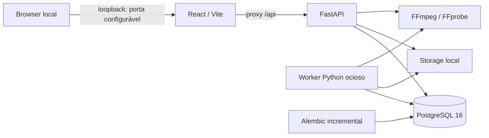

# Edivo — arquitetura executável R01/R02

As fontes de planejamento são os quatro documentos originais preservados em
`docs/`, complementados pelo contrato operacional R02. Este documento descreve
a fundação e a evolução autorizada; os resultados e critérios de aceite ficam
em `r01/acceptance.md` (histórico) e `r02/acceptance.md` (etapa atual).

O backend é um monólito modular. `app/api/v1` contém contratos HTTP de sistema,
projetos e mídias. Schemas validam entradas/saídas; serviços coordenam regras e
transações; repositórios consultam os modelos SQLAlchemy. `app/core` concentra
settings, erros, limite ASGI de entrada e logging; `app/db` mantém engine,
sessões e metadata; a integração FFmpeg detecta capacidades e inspeciona MP4
por subprocessos com argumentos controlados, timeout e saída limitada.
`app/worker/main.py` possui ciclo de vida próprio e compartilha configuração
com a API. Permanece ocioso, sem filas, jobs ou renderização.

`health` mede disponibilidade HTTP e não consulta banco/storage. `ready`
executa uma consulta PostgreSQL e verifica escrita/leitura/remoção de um
arquivo temporário no storage. `capabilities` informa exclusivamente o runtime
da API, com cache e motivos de indisponibilidade. O worker registra seu próprio
diagnóstico de inicialização, sem publicar porta nem status HTTP fictício.

Apenas o serviço `migrate` aplica Alembic durante o startup Compose. API e worker
aguardam a saúde do banco e a conclusão da migração. A baseline permanece
intacta. `0002_r02_projects_media` acrescenta somente `projects` e
`media_assets`: UUIDs, FK RESTRICT, constraints, índices de paginação e JSONB
controlado. Projetos têm exclusão lógica; arquivos e mídias são preservados.

Upload: limite ASGI do body (arquivo + overhead), parser multipart limitado
a um campo `file`, spool privado no storage, staging em chunks com SHA-256,
estrutura ISO BMFF e FFprobe restrito. A inspeção seleciona vídeo principal
deterministicamente, normaliza FPS/duração e decodifica um prefixo limitado;
não promete validação integral de cada frame do arquivo.

Antes da promoção, o serviço confirma novamente o projeto ativo com bloqueio
de linha e faz flush. Publica o original por hardlink exclusivo no mesmo
filesystem, sem substituir destinos, com modo 0400; depois confirma a transação.
Falhas confirmadas compensam apenas arquivos da operação atual. Se o resultado
do COMMIT não puder ser determinado após nova consulta sincronizada pelo lock
do projeto, o original é preservado e o evento é registrado. Uma queda abrupta
também pode deixar órfãos: `scripts/audit-storage.py` reconcilia por leitura e
hash, sem apagar arquivos. PostgreSQL e filesystem não formam transação única.

O banco usa volume nomeado `postgres_data`; API e worker montam `./storage` em
`/data/storage`, com UID/GID do usuário local e sem exposição estática. O backend
roda sem root, com filesystem da imagem somente leitura, `/tmp` temporário,
capabilities Linux removidas e `no-new-privileges`. PostgreSQL usa o entrypoint
oficial para preparar seu volume. Não há montagem de diretórios pessoais.

O frontend organiza shell/tema em `src/app`, status em `src/features/system`,
CRUD em `src/features/projects` e biblioteca em `src/features/media`,
componentes usados em `src/components` e cliente HTTP em `src/lib/api`. O browser
consulta URLs relativas `/api`; o proxy de desenvolvimento usa `api:8000` no
Compose e `127.0.0.1:8000` fora dele. Segredos nunca são variáveis `VITE_*`.

O arquivo `.env` é local e ignorado, criado com senha aleatória e modo 0600 por
`scripts/setup-local.py`. Logs e erros não devem incluir DSNs, senhas, payloads
privados ou stack traces. Publicação no host restrita a 127.0.0.1 nas portas
5173 e 8000 por padrão, configuráveis no host (8001/5174 neste ambiente).
As portas internas e o proxy são mantidos. Antes de qualquer exposição pública,
será necessária nova decisão
arquitetural envolvendo autenticação e autorização.
