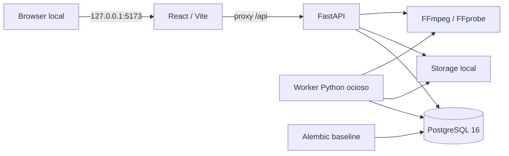

# Edivo — arquitetura executável da R01

As fontes de planejamento são os quatro documentos originais preservados em
`docs/`. Este documento descreve a implementação da fundação; o resultado de
execução e os critérios de aceite ficam em `r01/acceptance.md`.

O backend é um monólito modular. `app/api/v1` contém somente o contrato HTTP
de sistema. `app/core` concentra settings e logging; `app/db` mantém o engine,
sessões e metadata SQLAlchemy; serviços verificam dependências; a integração
FFmpeg detecta capacidades por subprocessos com argumentos fixos e timeout.
`app/worker/main.py` possui ciclo de vida próprio e compartilha configuração
com a API. Não há entidades de negócio, filas ou processamento de mídia.

`health` mede disponibilidade HTTP e não consulta banco/storage. `ready`
executa uma consulta PostgreSQL e verifica escrita/leitura/remoção de um
arquivo temporário no storage. `capabilities` informa exclusivamente o runtime
da API, com cache e motivos de indisponibilidade. O worker registra seu próprio
diagnóstico de inicialização, sem publicar porta nem status HTTP fictício.

Apenas o serviço `migrate` aplica Alembic durante o startup Compose. API e worker
aguardam a saúde do banco e a conclusão da migração. A baseline só registra
`alembic_version`; primeiras tabelas de domínio pertencem à R02.

O banco usa volume nomeado `postgres_data`; API e worker montam `./storage` em
`/data/storage`, com UID/GID do usuário local e sem exposição estática. O backend
roda sem root, com filesystem da imagem somente leitura, `/tmp` temporário,
capabilities Linux removidas e `no-new-privileges`. PostgreSQL usa o entrypoint
oficial para preparar seu volume. Não há montagem de diretórios pessoais.

O frontend organiza shell/tema em `src/app`, status em `src/features/system`,
componentes usados em `src/components` e cliente HTTP em `src/lib/api`. O browser
consulta URLs relativas `/api`; o proxy de desenvolvimento usa `api:8000` no
Compose e `127.0.0.1:8000` fora dele. Segredos nunca são variáveis `VITE_*`.

O arquivo `.env` é local e ignorado, criado com senha aleatória e modo 0600 por
`scripts/setup-local.py`. Logs e erros não devem incluir DSNs, senhas, payloads
privados ou stack traces. Publicação no host restrita a 127.0.0.1 nas portas
5173 e 8000. Antes de qualquer exposição pública, será necessária nova decisão
arquitetural envolvendo autenticação e autorização.
