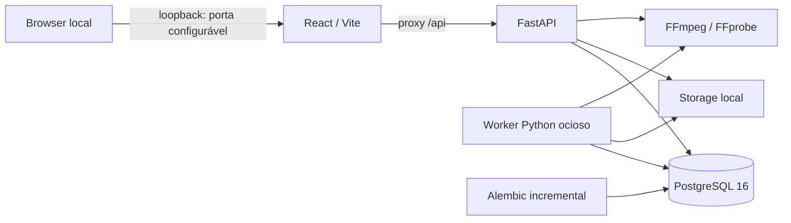

# Edivo — arquitetura executável R01/R02/R03

As fontes de planejamento são os quatro documentos originais preservados em
`docs/`, complementados pelos contratos operacionais R02/R03. Este documento descreve
a fundação e a evolução autorizada; os resultados e critérios de aceite ficam
em `r01/acceptance.md`, `r02/acceptance.md` (históricos) e `r03/acceptance.md`.

O backend é um monólito modular. `app/api/v1` contém contratos HTTP de sistema,
projetos, mídias e EditSpec. Schemas validam entradas/saídas; serviços coordenam regras e
transações; repositórios consultam os modelos SQLAlchemy. `app/core` concentra
settings, erros, limite ASGI de entrada e logging; `app/db` mantém engine,
sessões e metadata; a integração FFmpeg detecta capacidades e inspeciona MP4
por subprocessos com argumentos controlados, timeout e saída limitada.
`app/worker/main.py` possui ciclo de vida próprio e compartilha configuração
com a API. Permanece ocioso, sem filas, jobs ou renderização.

`health` mede disponibilidade HTTP e não consulta banco/storage. `ready`
executa uma consulta PostgreSQL e verifica escrita/leitura/remoção de um
arquivo temporário no storage. `capabilities` informa exclusivamente o runtime
da API, com cache e motivos de indisponibilidade. O worker registra seu próprio
diagnóstico de inicialização, sem publicar porta nem status HTTP fictício.

Apenas o serviço `migrate` aplica Alembic durante o startup Compose. API e worker
aguardam a saúde do banco e a conclusão da migração. A baseline permanece
intacta. `0002_r02_projects_media` acrescenta somente `projects` e
`media_assets`: UUIDs, FK RESTRICT, constraints, índices de paginação e JSONB
controlado. Projetos têm exclusão lógica; arquivos e mídias são preservados.

`0003_r03_edit_spec_revisions`, dependente de `0002_r02_projects_media`, cria
somente `edit_spec_revisions`. Cada linha possui UUID, projeto, fonte, sequência
por projeto, schema 1, JSONB validado e data UTC; FKs RESTRICT, índices e unique
`(project_id, revision_number)` reforçam a integridade. O save bloqueia Project
com `FOR UPDATE` antes de consultar a revisão atual. `expected_revision=0`
é obrigatório no primeiro save (201); revisões posteriores retornam 200.
Concorrentes com a mesma revisão esperada resultam em um sucesso e um 409.
Conteúdo idêntico com versão atual é no-op, sem nova revisão; versão antiga
sempre conflita. Proteções ORM e trigger PostgreSQL bloqueiam UPDATE/DELETE
de revisões. Não há listagem/restauração de histórico nesta etapa.

Upload: limite ASGI do body (arquivo + overhead), parser multipart limitado
a um campo `file`, spool privado no storage, staging em chunks com SHA-256,
estrutura ISO BMFF e FFprobe restrito. A inspeção seleciona vídeo principal
deterministicamente, normaliza FPS/duração e decodifica um prefixo limitado;
não promete validação integral de cada frame do arquivo.

Antes da promoção, o serviço confirma novamente o projeto ativo com bloqueio
de linha e faz flush. Publica o original por hardlink exclusivo no mesmo
filesystem, sem substituir destinos, com modo 0400; depois confirma a transação.
Falhas confirmadas compensam apenas arquivos da operação atual. Se o resultado
do COMMIT não puder ser determinado após nova consulta sincronizada pelo lock
do projeto, o original é preservado e o evento é registrado. Uma queda abrupta
também pode deixar órfãos: `scripts/audit-storage.py` reconcilia por leitura e
hash, sem apagar arquivos. PostgreSQL e filesystem não formam transação única.

Streaming GET/HEAD valida projeto ativo e associação da mídia. `LocalStorage`
exige a chave exata `originals/{project_uuid}/{media_uuid}/source.mp4`, abre cada
componente com `dir_fd/O_NOFOLLOW`, verifica arquivo regular e tamanho e fixa
o descritor. `PrivateMediaResponse` reutiliza `FileResponse` Starlette 1.8
para Range/HEAD e leitura limitada a 64 KiB, substituindo somente a abertura
para usar esse descritor. Pathsend é desativado para impedir reabertura do
caminho. O descritor fecha mesmo em cancelamento/HEAD/erro; a transação de
leitura PostgreSQL termina antes da transferência.

Range único fechado, aberto ou suffix produz 206 e os cabeçalhos de comprimento
e intervalo; ausência produz 200. Inválido/múltiplo/insatisfatível produz 416
sanitizado e `Content-Range: bytes */total`. HEAD não possui corpo.
`If-Range` usa ETag forte SHA-256/Last-Modified; divergência retorna 200.
Vídeos usam `private, no-store`, `nosniff` e `video/mp4`. Não existe endpoint
genérico de filesystem nem publicação estática de storage.

O banco usa volume nomeado `postgres_data`; API e worker montam `./storage` em
`/data/storage`, com UID/GID do usuário local e sem exposição estática. O backend
roda sem root, com filesystem da imagem somente leitura, `/tmp` temporário,
capabilities Linux removidas e `no-new-privileges`. PostgreSQL usa o entrypoint
oficial para preparar seu volume. Não há montagem de diretórios pessoais.

O frontend organiza shell/tema em `src/app`, status em `src/features/system`,
CRUD em `src/features/projects` e biblioteca em `src/features/media`,
editor em `src/features/editor`, componentes usados em `src/components` e
cliente HTTP em `src/lib/api`. O browser
consulta URLs relativas `/api`; o proxy de desenvolvimento usa `api:8000` no
Compose e `127.0.0.1:8000` fora dele. Segredos nunca são variáveis `VITE_*`.

O editor estende as rotas por hash com `#/projects/{uuid}/editor`. O player
HTML5 usa a URL relativa privada, eventos nativos e currentTime real; RAF
somente amostra esse tempo durante reprodução. A timeline de uma faixa mantém
playhead transitório separado do EditSpec (tempos inteiros ms). Trim é não
destrutivo. CSS aspect-ratio/object-fit/object-position representam quatro
presets, cover/contain e focal normalizado. Salvamento é explícito com revisão
esperada; guardas de navegação/troca de fonte e beforeunload protegem o draft.
Conflito mantém alterações locais e exige recarregamento consciente.

Rotação/display matrix, SAR e codecs dependem do decoder HTML5. VFR/keyframes
e precisão temporal do navegador impedem garantia frame-perfect. Os presets
não produzem filtros FFmpeg, preview codificado ou MP4 de saída. API e worker
mantêm os originais 0400 e não processam renders.

O arquivo `.env` é local e ignorado, criado com senha aleatória e modo 0600 por
`scripts/setup-local.py`. Logs e erros não devem incluir DSNs, senhas, payloads
privados ou stack traces. Publicação no host restrita a 127.0.0.1 nas portas
5173 e 8000 por padrão, configuráveis no host (8001/5174 neste ambiente).
As portas internas e o proxy são mantidos. Antes de qualquer exposição pública,
será necessária nova decisão
arquitetural envolvendo autenticação e autorização.
