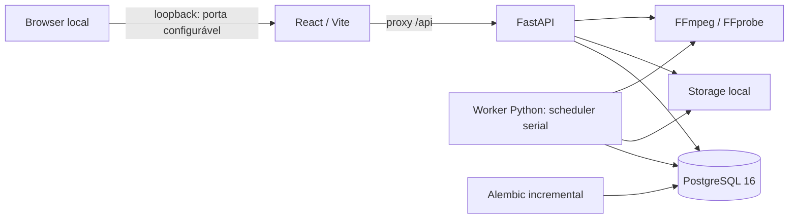

# Edivo — arquitetura executável e evolução R05

R01–R04 foram aceitas e permanecem preservadas. A R05 está **concluída**, com
gates R05.0–R05.5 e 22 critérios verificados: worker integrado, interface,
regressão completa, Chromium, persistência após reinício e auditoria final.
A especificação
[R05](R05_EDIVO_ESPECIFICACAO_OPERACIONAL.md) e a
[matriz de compatibilidade](r05/compatibility.md) reconciliam os contratos reais.
O [aceite R05](r05/acceptance.md) e o [QA](r05/qa-results.json) registram os resultados.
Relatórios R01–R04 continuam históricos e não são reescritos pela nova etapa.

O backend é um monólito modular. `app/api/v1` contém contratos HTTP de sistema,
projetos, mídias, MP3, EditSpec, prévias e exports. Schemas validam entradas/saídas;
serviços coordenam regras e transações; repositórios consultam os modelos
SQLAlchemy. `app/core` concentra
settings, erros, limite ASGI de entrada e logging; `app/db` mantém engine,
sessões e metadata; a integração FFmpeg detecta capacidades e inspeciona MP4
por subprocessos com argumentos controlados, timeout e saída limitada.
`app/worker/main.py` possui ciclo de vida próprio e compartilha configuração
com a API. Um scheduler escolhe PreviewJob ou RenderJob e executa um por vez, sem
codificação na requisição HTTP.

`health` mede disponibilidade HTTP e não consulta banco/storage. `ready`
executa uma consulta PostgreSQL e verifica escrita/leitura/remoção de um
arquivo temporário no storage. `capabilities` informa exclusivamente o runtime
da API, com cache e motivos de indisponibilidade. O worker registra seu próprio
diagnóstico de inicialização, sem publicar porta nem status HTTP fictício.

Apenas o serviço `migrate` aplica Alembic durante o startup Compose. API e worker
aguardam a saúde do banco e a conclusão da migração. A baseline permanece
intacta. `0002_r02_projects_media` acrescenta somente `projects` e
`media_assets`: UUIDs, FK RESTRICT, constraints, índices de paginação e JSONB
controlado. Projetos têm exclusão lógica; arquivos e mídias são preservados.

`0003_r03_edit_spec_revisions`, dependente de `0002_r02_projects_media`, cria
somente `edit_spec_revisions`. Cada linha possui UUID, projeto, fonte, sequência
por projeto, schema 1, JSONB validado e data UTC; FKs RESTRICT, índices e unique
`(project_id, revision_number)` reforçam a integridade. O save bloqueia Project
com `FOR UPDATE` antes de consultar a revisão atual. `expected_revision=0`
é obrigatório no primeiro save (201); revisões posteriores retornam 200.
Concorrentes com a mesma revisão esperada resultam em um sucesso e um 409.
Conteúdo idêntico com versão atual é no-op, sem nova revisão; versão antiga
sempre conflita. Proteções ORM e trigger PostgreSQL bloqueiam UPDATE/DELETE
de revisões. Não há listagem/restauração de histórico nesta etapa.

`0004_r04_text_audio_previews` amplia somente o CHECK de schema para 1/2 e cria
AudioAsset e PreviewJob. O primeiro mantém MP3 em inventário/namespace próprio,
sem reinterpretar MediaAsset. O segundo mantém a fila transacional de prévias,
lease, heartbeat, token de posse e tentativas limitadas. V1/v2 são uniões discriminadas tipadas,
e revisões antigas não são convertidas no banco. V2 contém até três textos e
áudio controlado (volumes/música/loop/fades), sem comandos de renderização.

MP3 possui limites independentes na entrada ASGI, parser e staging. Framing
integral soma duração racional e a compara com FFprobe, evitando índices
Info/Xing forjados; prefixo de até dois segundos é decodificado. Promoção,
SHA-256/0400, compensação e COMMIT incerto seguem os mesmos princípios dos MP4.
No frontend, draft e baseline v1 são normalizados igualmente em memória para
v2; nenhuma abertura/seek salva implicitamente. Textos CSS seguem currentTime,
com fonte local licenciada e medição memoizada. Música/fades/ganho acima de 100%
são avaliados no player separado da prévia codificada.

Upload: limite ASGI do body (arquivo + overhead), parser multipart limitado
a um campo `file`, spool privado no storage, staging em chunks com SHA-256,
estrutura ISO BMFF e FFprobe restrito. A inspeção seleciona vídeo principal
deterministicamente, normaliza FPS/duração e decodifica um prefixo limitado;
não promete validação integral de cada frame do arquivo.

Antes da promoção, o serviço confirma novamente o projeto ativo com bloqueio
de linha e faz flush. Publica o original por hardlink exclusivo no mesmo
filesystem, sem substituir destinos, com modo 0400; depois confirma a transação.
Falhas confirmadas compensam apenas arquivos da operação atual. Se o resultado
do COMMIT não puder ser determinado após nova consulta sincronizada pelo lock
do projeto, o original é preservado e o evento é registrado. Uma queda abrupta
também pode deixar órfãos: `scripts/audit-storage.py` reconcilia por leitura e
hash, sem apagar arquivos. PostgreSQL e filesystem não formam transação única.

Streaming GET/HEAD valida projeto ativo e associação da mídia. `LocalStorage`
exige a chave exata `originals/{project_uuid}/{media_uuid}/source.mp4`, abre cada
componente com `dir_fd/O_NOFOLLOW`, verifica arquivo regular e tamanho e fixa
o descritor. `PrivateMediaResponse` reutiliza `FileResponse` Starlette 1.8
para Range/HEAD e leitura limitada a 64 KiB, substituindo somente a abertura
para usar esse descritor. Pathsend é desativado para impedir reabertura do
caminho. O descritor fecha mesmo em cancelamento/HEAD/erro; a transação de
leitura PostgreSQL termina antes da transferência.

Range único fechado, aberto ou suffix produz 206 e os cabeçalhos de comprimento
e intervalo; ausência produz 200. Inválido/múltiplo/insatisfatível produz 416
sanitizado e `Content-Range: bytes */total`. HEAD não possui corpo.
`If-Range` usa ETag forte SHA-256/Last-Modified; divergência retorna 200.
Vídeos usam `private, no-store`, `nosniff` e `video/mp4`. Não existe endpoint
genérico de filesystem nem publicação estática de storage.

O banco usa volume nomeado `postgres_data`; API e worker montam `./storage` em
`/data/storage`, com UID/GID do usuário local e sem exposição estática. O backend
roda sem root, com filesystem da imagem somente leitura, `/tmp` temporário,
capabilities Linux removidas e `no-new-privileges`. PostgreSQL usa o entrypoint
oficial para preparar seu volume. Não há montagem de diretórios pessoais.

O frontend organiza shell/tema em `src/app`, status em `src/features/system`,
CRUD em `src/features/projects` e biblioteca em `src/features/media`,
editor em `src/features/editor`, componentes usados em `src/components` e
cliente HTTP em `src/lib/api`. O browser
consulta URLs relativas `/api`; o proxy de desenvolvimento usa `api:8000` no
Compose e `127.0.0.1:8000` fora dele. Segredos nunca são variáveis `VITE_*`.

O editor estende as rotas por hash com `#/projects/{uuid}/editor`. O player
HTML5 usa a URL relativa privada, eventos nativos e currentTime real; RAF
somente amostra esse tempo durante reprodução. A timeline de uma faixa mantém
playhead transitório separado do EditSpec (tempos inteiros ms). Trim é não
destrutivo. CSS aspect-ratio/object-fit/object-position representam quatro
presets, cover/contain e focal normalizado. Salvamento é explícito com revisão
esperada; guardas de navegação/troca de fonte e beforeunload protegem o draft.
Conflito mantém alterações locais e exige recarregamento consciente.

Rotação/display matrix, SAR e codecs dependem do decoder HTML5. VFR/keyframes
e precisão temporal do navegador impedem garantia frame-perfect. A representação
CSS continua local. A R04 acrescenta prévia curta codificada no worker, com
enquadramento correspondente, autorrotação, SAR 1 e FPS 24. API e worker mantêm
os originais 0400; a exportação completa R05 usa o mesmo núcleo, com outro perfil.

O arquivo `.env` é local e ignorado, criado com senha aleatória e modo 0600 por
`scripts/setup-local.py`. Logs e erros não devem incluir DSNs, senhas, payloads
privados ou stack traces. Publicação no host restrita a 127.0.0.1 nas portas
5173 e 8000 por padrão, configuráveis no host (8001/5174 neste ambiente).
As portas internas e o proxy são mantidos. Antes de qualquer exposição pública,
será necessária nova decisão
arquitetural envolvendo autenticação e autorização.

## Processamento de prévias R04

`services/previews.py` valida revisão salva/janela, bloqueia Project e cria ou
reutiliza um job equivalente por perfil/revisão/janela efetiva. O índice parcial
único abrange queued/running/completed; failed permite uma nova solicitação.
Até dois jobs ativos por projeto. Somente artefato íntegro pode ser reutilizado
com 200; pendente retorna 202. GET/HEAD do arquivo reaproveitam o leitor privado
R03, após verificação de modo/tamanho/SHA-256 e associação ao projeto ativo.
Projetos excluídos tornam seus jobs e arquivos inacessíveis, preservando os
registros e bytes. O estado de um job concluído não é atribuído a outra revisão
ou a alterações locais ainda não salvas.

`worker/preview_worker.py` faz claim com SKIP LOCKED e confirma antes de processar.
As transições exigem token, running e lease ainda válido. Usa clock_timestamp
para observar o relógio inclusive após espera por lock. Heartbeat renova a
execução; lease expirado permite até a segunda tentativa. Falhas determinísticas
são terminais. SIGTERM pede parada, termina processos descendentes e permite
retry finito; SIGKILL exige recuperação por lease.

`worker/processor.py` carrega o snapshot v1/v2, verifica fonte/música, SHA-256 e
0400 por descritores fixados e cria workspace exclusivo. O compositor só recebe
dados tipados/allowlists e descritores internos. FFmpeg recebe inputs fixados em
`/proc/self/fd`, com `pass_fds`, demuxers MOV/MP3 específicos, protocolos locais
e referências externas MOV desabilitadas; não reabre paths fornecidos pelo browser.
`ffmpeg/preview.py` aplica
enquadramento, textos por textfiles UTF-8, áudio/loop/fades no relógio completo
do trim, H.264/AAC e faststart. Resolve orientação e SAR e valida todo artefato
por FFprobe e decodificação completa, contagem de frames, tamanho e checksum.
A resolução 4:5 é 544×680 para yuv420p. Fonte DejaVu Sans fixa, SHA verificado,
métricas FreeType e licença local; glifo ausente falha explicitamente. Cada linha
de texto é centralizada separadamente, com até duas linhas por overlay e três
overlays. Textos longos têm o tamanho reduzido para caber na margem segura de 7%.

Trim, textos e janela usam milissegundos absolutos da fonte. A música começa no
zero relativo do trim completo; uma prévia intermediária usa o offset musical
correspondente. Fades do mix também seguem os extremos do trim completo. Música
esgotada sem loop produz silêncio; fonte sem áudio não exige uma faixa sonora.
Áudio da fonte preserva silêncio inicial e sincronismo durante seek e preroll.

A janela solicitada é de 1–8000 ms, truncada ao fim do trim. A amostragem CFR de
24 fps pode quantizar seus limites em até um quadro, mais 1 ms de arredondamento
do MP4. Uma janela de 1 ms pode resultar em um quadro de 41,667 ms e duração de
container 42 ms; o limite absoluto do artefato é 8,001 s. A prévia não representa
precisão por frame nem exportação final.

Publicação usa lock Project→PreviewJob, checagem de posse antes/depois do
hardlink exclusivo e commit de completed. Não remove arquivo canônico após
COMMIT incerto. Um destino encontrado numa retomada falha como publicação
interrompida e é preservado; só uma nova solicitação explícita cria outro UUID.
Não há retenção destrutiva automática. `scripts/audit-storage-r04.py` reconcilia
MP4/MP3/prévias e temporários por leitura, incluindo projetos soft-deleted.

`worker/supervisor.py` aplica prazo global de 120 s, heartbeat, stdout/stderr
limitados e encerramento do grupo de processos. Launcher interno confiável
aplica AS, CPU, tamanho de arquivo e FDs sem preexec_fn; ambiente de subprocessos
não recebe DSN. Compose limita somente o worker a 2 CPUs, 1,5 GiB e 128 PIDs,
com Tini. Polling ocioso espera por Event. Não usa BackgroundTasks, Redis ou Celery.

`PreviewPanel` mantém referência de job por projeto no armazenamento local e
sempre a revalida. Polling de cerca de 2 s, abortado ao sair/terminar, exibe
estágios reais sem percentuais. Draft dirty impede solicitação e nenhum PUT
é implícito. O resultado mantém sua revisão/janela; dois players nativos se
pausam mutuamente por eventos reais. Não existe chat, prompt ou integração IA.

## Limites das evidências

O QA de navegador é feito somente em Chromium headless do container oficial
Playwright; não cobre Firefox/WebKit ou dispositivos físicos. Viewports mobile,
orientação e toque são emulados. A matriz de composição usa fontes sintéticas
e inspeção visual de quadros. Áudio é avaliado objetivamente por RMS, frequências,
picos e temporização; não houve escuta humana nem estudo subjetivo de fala.
Rasterização CSS/FreeType, VFR, keyframes e seek limitam equivalência por pixel
ou frame. A [regressão final](r04/evidence/final-regression-summary.json) registra
692 casos backend e oito PostgreSQL opt-in aprovados separadamente, 149 testes
frontend e lint/build aprovados. O harness bruto interrompido no Vitest permanece
preservado, junto das duas reexecuções aprovadas sem alteração de fontes.

R05 acrescenta exportações completas e cancelamento local conforme descrito
abaixo. A validação histórica R04 não comprova automaticamente a nova interface.
Chromium R05 foi validado separadamente, inclusive na imagem final após reinício;
nenhuma validação humana de áudio é presumida. R06 e integrações de IA não foram iniciadas.

## RenderJob e API R05

`0005_r05_render_exports` depende de `0004_r04_text_audio_previews` e cria somente
`render_jobs`. Não altera tabelas/revisões/triggers nem migrations históricas.
RenderJob mantém UUIDs de projeto/revisão, perfil e versão do motor, identidade
idempotente/fingerprint, estado/estágio, tentativas, lease/token/heartbeat,
intenção de cancelamento, progresso, datas UTC, erro seguro e metadados reais
do artefato. FKs RESTRICT, CHECKs de status/perfil/tentativas/completed e índices
de fila, lease, equivalência e histórico reforçam os contratos. O índice único
parcial permite só um render queued/running por projeto.

O snapshot EditSpec salvo é a única fonte do plano. V1 recebe defaults neutros
em memória e v2 mantém textos/áudio exatamente salvos; nenhum snapshot é
convertido no banco. Render continua na revisão original se houver novo save.
Revisões permanecem append-only e saves idênticos permanecem no-op com a revisão
esperada correta. Não há save implícito na API de render.

`schemas/renders.py`, `repositories/render_jobs.py`, `services/renders.py` e
`api/v1/renders.py` mantêm a separação do monólito. Sob o namespace do projeto:

| Método | Rota                          | Comportamento                                                             |
| ------ | ----------------------------- | ------------------------------------------------------------------------- |
| POST   | `/renders`                    | 202 ativo; 200 reuso íntegro/replay terminal conhecido                    |
| GET    | `/renders`                    | Página de histórico, filtro status opcional                               |
| GET    | `/renders/{render_id}`        | Estado, progresso, revisão e metadados públicos                           |
| POST   | `/renders/{render_id}/cancel` | Intenção running 202, queued/já canceled 200, terminal não cancelável 409 |
| GET    | `/renders/{render_id}/file`   | Download privado completed íntegro, 200/206/416                           |
| HEAD   | `/renders/{render_id}/file`   | Cabeçalhos equivalentes e corpo vazio                                     |

A entrada usa `edit_spec_revision_id`; saída usa `revision_id`, `revision_number`
e URLs relativas, coerentes com PreviewJob. Nunca retorna storage key, token,
lease, path, argv ou credenciais. Erros mantêm `{code,message,request_id}` e
`X-Request-ID`. Projetos excluídos e vínculos de outro projeto retornam 404.

Histórico ordena `created_at DESC,id DESC`, padrão 20/0, limit 1–100 e offset >= 0.
Verifica presença/modo/tamanho sem reler até 2 GiB por item. Consulta individual,
reuso e download conferem SHA-256 completo. Logo, a disponibilidade indicada na
lista não substitui a validação integral ao abrir o resultado. Artefato completed
corrompido/ausente fica indisponível, com `render_artifact_unavailable`; seu estado
terminal e metadados históricos não são reescritos. Download e replay da mesma chave retornam 503; solicitação sem chave pode
ignorar esse equivalente inválido e criar outro job. GET de status 200 informa erro seguro e `artifact_available=false`.

Uma chave UUID explícita é permanente por projeto. Mesmos parâmetros retornam o
mesmo job; divergência causa `idempotency_conflict` 409. Failed/canceled não
reabrem: replay retorna 200 e uma nova solicitação exige nova chave. Novo UUID de
chave não é associado silenciosamente ao job de outra chave. Sem chave, pode
reutilizar fingerprint equivalente ativo/completed íntegro. Fingerprint inclui
projeto, revisão, perfil e motor `r05-1`, que representa os parâmetros efetivos
fixos; mesma chave com motor incompatível retorna `render_engine_conflict` 409.
O limite ativo retorna `render_active_limit` 409, impedindo fila ilimitada por
projeto quando o worker estiver offline.

A admissão também limita a soma global de renders queued/running a 20 por
padrão (`EDIVO_RENDER_MAX_ACTIVE_TOTAL`, 1–1000). Após replay/reuso, novas
criações obtêm um advisory lock transacional PostgreSQL exclusivo do namespace
Edivo render e verificam COUNT/INSERT na mesma transação, mantendo a ordem
Project→advisory. Não há novo serviço ou fila. Excesso retorna
`409 render_queue_full`; jobs ativos de projetos excluídos contam até a
recuperação existente marcá-los failed. Estados terminais liberam capacidade.

## Compositor e supervisão compartilhados

`ffmpeg/preview.py` possui um único `_render_composition`, `CompositionProfile`,
wrappers `render_preview`/`render_final` e o mesmo validador completo. A prévia
preserva 24 fps, veryfast/CRF28/AAC 128k, dimensões reduzidas e teto 8 s. O final
compõe diretamente todo o trim, sem concatenação de prévias, com estas saídas:

| Preset | Resolução final |
| ------ | --------------- |
| 9:16   | 1080×1920       |
| 1:1    | 1080×1080       |
| 4:5    | 1080×1350       |
| 16:9   | 1920×1080       |

Final sempre H.264/libx264, yuv420p, CFR 30, SAR 1:1 e MP4 faststart. Perfil
standard: veryfast/CRF23/AAC160k; high: medium/CRF20/AAC192k. AAC 48 kHz estéreo
quando houver áudio; fonte silenciosa sem música pode produzir vídeo sem áudio.
Respeita autorrotação, DAR/SAR, VFR, cover/contain, focal, textos e controles
salvos. Tempos de fonte são absolutos; música inicia no zero relativo do trim
e fades seguem o trim inteiro. A tolerância medida é 1/30 s + 1 ms, cerca de 34,333 ms;
não se promete seek/frame-perfect nem paridade de rasterização CSS/FreeType.

Inputs continuam fixados em descritores NOFOLLOW, SHA-256/0400 conferidos antes
de executar. Argv é allowlisted, sem shell, com `-nostdin`, protocolos locais,
fontes aprovadas e textfiles UTF-8 privados sem expansão. `ProcessPolicy` separa
orçamentos de prévia/render sem duplicar o supervisor. Defaults finais: prazo
máximo global 3600 s, CPU 3600 s por processo, AS 1 GiB, duas threads, resultado até 2 GiB,
stderr/output 256 KiB e progresso 16 MiB consumido incrementalmente. Esses tetos não
são SLA de desempenho. Settings valida limites e valores finitos; todas as
variáveis `EDIVO_RENDER_*` constam no README e `.env.example`.

O ambiente controlado dos subprocessos render inclui `MALLOC_ARENA_MAX=2`,
constante interna para limitar as arenas glibc sob o teto de AS, sem aumentar
recursos ou mudar os perfis. Prévias mantêm seu ambiente anterior. O
[diagnóstico high/4:5](r05/compatibility.md#reserva-de-memória-do-alocador--diagnóstico-r053)
preserva a falha original de alocação e a repetição isolada validada, distinguindo
reserva virtual de RSS. Isso não substitui a validação HTTP/publicação do job.

`FFmpegProgress` interpreta linhas limitadas sem acumular stdout indefinidamente.
FFmpeg 5.1.9 foi medido com 1 s/30 frames: `out_time_us` e o alias `out_time_ms`
ambos 1000000, em microssegundos. O worker persiste avanço monotônico por tentativa
aproximadamente a cada 1 s; percentual existe só em encoding e é limitado a 99.
Validating/publishing são indeterminados; 100 só aparece após completed persistido.

A validação exige tamanho positivo/dentro do teto, container MP4, H.264/yuv420p,
dimensões/FPS/SAR/duração esperados, AAC/presença de áudio coerentes, faststart,
decode integral com contagem de frames e SHA-256. Exit code zero não basta.
`amix normalize=0` conserva o comportamento R04: ganhos altos podem clipar
fontes arbitrárias. Métricas sintéticas de RMS/peak não substituem escuta humana.

## Scheduler, cancelamento e publicação R05

`worker/scheduler.py` seleciona candidatos PreviewJob/RenderJob em uma transação
curta com SKIP LOCKED e ordem fixa das filas; escolhe FIFO entre candidatos
atualmente elegíveis/desbloqueados. Confirma o claim antes de iniciar o processor.
Não existe segundo loop desconectado nem preempção; um FFmpeg por worker, um
worker Compose por padrão. Cgroup 2 CPUs/1536 MiB/128 PIDs, Tini, usuário sem root e
capabilities removidas continuam preservados. Espera ociosa usa Event.

`RenderWorker`/`RenderLeaseController` reutilizam lease/token e supervisão do
worker R04. Transições CAS exigem running, token, projeto ativo e lease válido,
com `clock_timestamp()` fresco. Defaults: lease 30 s, heartbeat 5 s, consulta de
cancelamento 0,5 s, grace 2 s e até duas tentativas. Cada nova tentativa zera seu
progresso; estados terminais não retornam a ativos. SIGTERM/SIGINT interrompe
somente o grupo pertencente ao job e permite retry finito; perda de posse para
imediatamente e não autoriza publicar. Crash requer reconciliação por lease,
sem adoção/sobrescrita de canônicos encontrados.

A API nunca sinaliza processos. Queued→canceled é atômico. Em running persiste
`cancel_requested_at`; o supervisor observa a intenção, termina seu próprio
grupo SIGTERM/grace/SIGKILL e só após encerramento/cleanup confirma canceled.
Criação, cancelamento e publicação respeitam Project→Job; o claim de fila usa
locks SKIP LOCKED dos candidatos. Cancel persistido antes da finalização bloqueia
completed; se a publicação já confirmou completed, o cancelamento recebe 409.

`RenderProcessor` resolve o snapshot e mídias autorizadas, cria workspace privado
por job/token, compõe/valida, revalida hash e publica sem overwrite. Antes de
executar reserva espaço para o teto configurado mais a margem livre; falta de
espaço falha sanitizada e não apaga mídia. Namespace final:
`renders/{project_uuid}/{render_uuid}/final.mp4`, modo 0400. A transação curta de
publicação bloqueia Project→RenderJob e revalida posse/cancelamento antes/depois
da promoção exclusiva. Completed só é anunciado após commit confirmado.

Commit incerto preserva artefatos para reconciliação conservadora. Só temporários
inequivocamente pertencentes à tentativa são limpos; originais, prévias, exports
concluídos e arquivos desconhecidos não são apagados. Auditoria
`scripts/audit-storage-r05.py` reconcilia somente por leitura, incluindo espaço
e potenciais órfãos. `scripts/r05-preservation.py` compara baseline de documentos,
migrations/locks, rows históricos, trigger, SHA/modos, Git e ObraControl.

Download usa o leitor por FD existente, GET/HEAD e Range 200/206/416, com
`video/mp4`, `private, no-store`, `nosniff` e attachment. Filename é gerado como
`edivo-r8-9x16-standard.mp4` a partir de campos allowlisted; nenhum nome de
upload entra nesse header. Não existe StaticFiles público ou endpoint genérico.

## Exportação no editor React

`features/editor/export-panel.tsx` integra-se ao `EditorWorkspace` existente,
mantendo player, timeline, textos, áudio, prévias, dirty state e hash routing.
`lib/api/renders.ts` contém contratos tipados e valida respostas por identidade,
projeto, revisão/perfil, estados, metadados e URLs relativas do namespace correto.
Nenhuma URL arbitrária retornada é aceita como fonte do player/download.

Solicitar render exige revisão salva, draft limpo e ação explícita. O perfil
é standard/high, com resolução derivada do canvas da revisão. Antes do POST,
a identidade da requisição é persistida por projeto; resposta incerta conserva
a chave para repetição explícita idempotente. Reload não repete POST nem salva
o draft automaticamente. Falha de conectividade é distinta de job failed.

Monitoramento ativo e resultado selecionado possuem referências independentes:
ver um resultado anterior não interrompe polling do trabalho atual. IDs locais
são revalidados no servidor; quando ausentes, o histórico permite recuperar
o job. Polling é serial, cerca de 2 s, com AbortController/deadline e cleanup de
timer ao desmontar, trocar ID ou atingir terminal. A falha de consulta apresenta
recuperação explícita, preservando o ID. Não utiliza WebSocket.

Somente encoding medido apresenta progress bar; demais estágios são
indeterminados. Cancelamento exige confirmação em modal e acompanha a intenção
até resposta real do worker. Histórico paginado em 20 itens mantém terminais,
identifica revisão anterior e oferece nova tentativa explícita com nova chave.
Um resultado completed disponível possui vídeo HTML5 e link privado attachment;
codec/rede recebem feedback e opção de recarregar. Os três players compartilham
pausa mútua por eventos nativos. CSS preserva temas e reorganiza o painel em telas
menores; testes de unidade não substituem a validação real em Chromium.

O gate R05.4 passou inicialmente com 312 testes frontend; a correção da admissão
global acrescentou um caso de cliente HTTP. A [regressão final Docker](r05/evidence/full-compose-final-summary.json)
passou com **313 frontend**, ESLint, Prettier e build TypeScript/Vite.
A [união distinta JUnit](r05/evidence/backend-distinct-final-counts.json) confirmou
**1140 backend**: 1110 padrão e 30 PG opt-in, sem overlap nem reexecuções
somadas. Os nove testes Python host do harness do navegador ficam separados,
assim como 29 checks operacionais Compose, HTTP/FFmpeg e Chromium.

A [queda real do PostgreSQL durante encoding](r05/evidence/db-outage-attempt-1/report.json)
passou em 37 verificações, com filas ociosas e worker principal previamente
parado pelo operador. Uma tentativa dedicada perdeu a confirmação de posse e
encerrou seu próprio subprocesso sem artefato; após restaurar o mesmo banco, uma segunda
tentativa com token novo concluiu o render de 12 s, validado integralmente.
O original manteve SHA/0400/mtime. Falta de espaço, fsync e COMMIT incerto ainda
usam injeção de falhas; essa distinção permanece explícita nas evidências.

O [Chromium 145 real](r05/evidence/browser-attempt-1/r05-export-1792717682595939151.json)
passou em 15 verificações, incluindo export completo de 12 s, progresso medido,
play/seek/pause nativos, download/SHA, Range e cancelamento durante encoding.
A [verificação na imagem final](r05/evidence/browser-attempt-3/r05-verify-1792720452716863901.json)
passou em cinco após reinício, com revisão, histórico e arquivo preservados.
Desktop e mobile emulados 375/390 px, temas e teclado foram exercitados; não
houve cobertura de outros navegadores/dispositivos físicos ou escuta humana.

A [verificação final integrada](r05/evidence/post-admission-verification-summary.json)
confirmou renders, prévia R04, Chromium e preservação após reinício. A
[auditoria de storage](r05/evidence/storage-admission-final.json) conferiu 197 MP4,
dez MP3, oito prévias e 14 arquivos finais, com zero temporários, arquivos
desconhecidos ou divergências. A [preservação do baseline](r05/evidence/preservation-admission-final.json)
conferiu 165 arquivos históricos, 94 artefatos anteriores, rows/revisões/trigger,
locks, Git e cinco containers ObraControl. [Hashes das fontes no runtime](r05/evidence/final-runtime-source-hashes.json)
correspondem ao checkout validado em API, worker e frontend.

## Gates e continuidade

A auditoria, migration/API, compositor, scheduler/cancelamento, UI/histórico e
QA final passaram pelos gates R05.0–R05.5, com **22/22 critérios** e evidências
separadas. Negativas iniciais e suas resoluções permanecem na cronologia.
O sistema está tecnicamente pronto para R06, que não foi iniciada e requer
nova autorização. Heditor, LLM/agentes, prompts, Higgsfield, filas
distribuídas, Redis/Celery, WebSocket, 4K e novos formatos não entram na R05.
