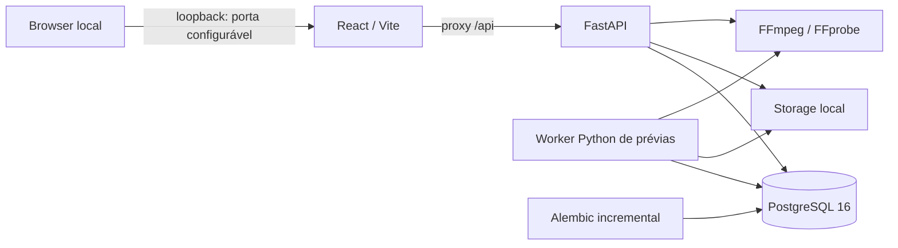

# Edivo — arquitetura executável e evolução R04

As fontes de planejamento são os quatro documentos originais preservados em
`docs/`, complementados pelos contratos operacionais R02/R03/R04. Este documento descreve
a fundação e a evolução autorizada; os resultados e critérios de aceite ficam
em `r01/acceptance.md`, `r02/acceptance.md`, `r03/acceptance.md` (históricos)
e `r04/acceptance.md`. A R04 está concluída tecnicamente, com os critérios
essenciais validados e limitações registradas na
[regressão final consolidada](r04/evidence/final-regression-summary.json).

O backend é um monólito modular. `app/api/v1` contém contratos HTTP de sistema,
projetos, mídias, MP3, EditSpec e prévias. Schemas validam entradas/saídas;
serviços coordenam regras e transações; repositórios consultam os modelos
SQLAlchemy. `app/core` concentra
settings, erros, limite ASGI de entrada e logging; `app/db` mantém engine,
sessões e metadata; a integração FFmpeg detecta capacidades e inspeciona MP4
por subprocessos com argumentos controlados, timeout e saída limitada.
`app/worker/main.py` possui ciclo de vida próprio e compartilha configuração
com a API. Processa um PreviewJob por vez, sem codificação na requisição HTTP.

`health` mede disponibilidade HTTP e não consulta banco/storage. `ready`
executa uma consulta PostgreSQL e verifica escrita/leitura/remoção de um
arquivo temporário no storage. `capabilities` informa exclusivamente o runtime
da API, com cache e motivos de indisponibilidade. O worker registra seu próprio
diagnóstico de inicialização, sem publicar porta nem status HTTP fictício.

Apenas o serviço `migrate` aplica Alembic durante o startup Compose. API e worker
aguardam a saúde do banco e a conclusão da migração. A baseline permanece
intacta. `0002_r02_projects_media` acrescenta somente `projects` e
`media_assets`: UUIDs, FK RESTRICT, constraints, índices de paginação e JSONB
controlado. Projetos têm exclusão lógica; arquivos e mídias são preservados.

`0003_r03_edit_spec_revisions`, dependente de `0002_r02_projects_media`, cria
somente `edit_spec_revisions`. Cada linha possui UUID, projeto, fonte, sequência
por projeto, schema 1, JSONB validado e data UTC; FKs RESTRICT, índices e unique
`(project_id, revision_number)` reforçam a integridade. O save bloqueia Project
com `FOR UPDATE` antes de consultar a revisão atual. `expected_revision=0`
é obrigatório no primeiro save (201); revisões posteriores retornam 200.
Concorrentes com a mesma revisão esperada resultam em um sucesso e um 409.
Conteúdo idêntico com versão atual é no-op, sem nova revisão; versão antiga
sempre conflita. Proteções ORM e trigger PostgreSQL bloqueiam UPDATE/DELETE
de revisões. Não há listagem/restauração de histórico nesta etapa.

`0004_r04_text_audio_previews` amplia somente o CHECK de schema para 1/2 e cria
AudioAsset e PreviewJob. O primeiro mantém MP3 em inventário/namespace próprio,
sem reinterpretar MediaAsset. O segundo mantém a fila transacional de prévias,
lease, heartbeat, token de posse e tentativas limitadas. V1/v2 são uniões discriminadas tipadas,
e revisões antigas não são convertidas no banco. V2 contém até três textos e
áudio controlado (volumes/música/loop/fades), sem comandos de renderização.

MP3 possui limites independentes na entrada ASGI, parser e staging. Framing
integral soma duração racional e a compara com FFprobe, evitando índices
Info/Xing forjados; prefixo de até dois segundos é decodificado. Promoção,
SHA-256/0400, compensação e COMMIT incerto seguem os mesmos princípios dos MP4.
No frontend, draft e baseline v1 são normalizados igualmente em memória para
v2; nenhuma abertura/seek salva implicitamente. Textos CSS seguem currentTime,
com fonte local licenciada e medição memoizada. Música/fades/ganho acima de 100%
são avaliados no player separado da prévia codificada.

Upload: limite ASGI do body (arquivo + overhead), parser multipart limitado
a um campo `file`, spool privado no storage, staging em chunks com SHA-256,
estrutura ISO BMFF e FFprobe restrito. A inspeção seleciona vídeo principal
deterministicamente, normaliza FPS/duração e decodifica um prefixo limitado;
não promete validação integral de cada frame do arquivo.

Antes da promoção, o serviço confirma novamente o projeto ativo com bloqueio
de linha e faz flush. Publica o original por hardlink exclusivo no mesmo
filesystem, sem substituir destinos, com modo 0400; depois confirma a transação.
Falhas confirmadas compensam apenas arquivos da operação atual. Se o resultado
do COMMIT não puder ser determinado após nova consulta sincronizada pelo lock
do projeto, o original é preservado e o evento é registrado. Uma queda abrupta
também pode deixar órfãos: `scripts/audit-storage.py` reconcilia por leitura e
hash, sem apagar arquivos. PostgreSQL e filesystem não formam transação única.

Streaming GET/HEAD valida projeto ativo e associação da mídia. `LocalStorage`
exige a chave exata `originals/{project_uuid}/{media_uuid}/source.mp4`, abre cada
componente com `dir_fd/O_NOFOLLOW`, verifica arquivo regular e tamanho e fixa
o descritor. `PrivateMediaResponse` reutiliza `FileResponse` Starlette 1.8
para Range/HEAD e leitura limitada a 64 KiB, substituindo somente a abertura
para usar esse descritor. Pathsend é desativado para impedir reabertura do
caminho. O descritor fecha mesmo em cancelamento/HEAD/erro; a transação de
leitura PostgreSQL termina antes da transferência.

Range único fechado, aberto ou suffix produz 206 e os cabeçalhos de comprimento
e intervalo; ausência produz 200. Inválido/múltiplo/insatisfatível produz 416
sanitizado e `Content-Range: bytes */total`. HEAD não possui corpo.
`If-Range` usa ETag forte SHA-256/Last-Modified; divergência retorna 200.
Vídeos usam `private, no-store`, `nosniff` e `video/mp4`. Não existe endpoint
genérico de filesystem nem publicação estática de storage.

O banco usa volume nomeado `postgres_data`; API e worker montam `./storage` em
`/data/storage`, com UID/GID do usuário local e sem exposição estática. O backend
roda sem root, com filesystem da imagem somente leitura, `/tmp` temporário,
capabilities Linux removidas e `no-new-privileges`. PostgreSQL usa o entrypoint
oficial para preparar seu volume. Não há montagem de diretórios pessoais.

O frontend organiza shell/tema em `src/app`, status em `src/features/system`,
CRUD em `src/features/projects` e biblioteca em `src/features/media`,
editor em `src/features/editor`, componentes usados em `src/components` e
cliente HTTP em `src/lib/api`. O browser
consulta URLs relativas `/api`; o proxy de desenvolvimento usa `api:8000` no
Compose e `127.0.0.1:8000` fora dele. Segredos nunca são variáveis `VITE_*`.

O editor estende as rotas por hash com `#/projects/{uuid}/editor`. O player
HTML5 usa a URL relativa privada, eventos nativos e currentTime real; RAF
somente amostra esse tempo durante reprodução. A timeline de uma faixa mantém
playhead transitório separado do EditSpec (tempos inteiros ms). Trim é não
destrutivo. CSS aspect-ratio/object-fit/object-position representam quatro
presets, cover/contain e focal normalizado. Salvamento é explícito com revisão
esperada; guardas de navegação/troca de fonte e beforeunload protegem o draft.
Conflito mantém alterações locais e exige recarregamento consciente.

Rotação/display matrix, SAR e codecs dependem do decoder HTML5. VFR/keyframes
e precisão temporal do navegador impedem garantia frame-perfect. A representação
CSS continua local. A R04 acrescenta prévia curta codificada no worker, com
enquadramento correspondente, autorrotação, SAR 1 e FPS 24. API e worker mantêm
os originais 0400; não há exportação final.

O arquivo `.env` é local e ignorado, criado com senha aleatória e modo 0600 por
`scripts/setup-local.py`. Logs e erros não devem incluir DSNs, senhas, payloads
privados ou stack traces. Publicação no host restrita a 127.0.0.1 nas portas
5173 e 8000 por padrão, configuráveis no host (8001/5174 neste ambiente).
As portas internas e o proxy são mantidos. Antes de qualquer exposição pública,
será necessária nova decisão
arquitetural envolvendo autenticação e autorização.

## Processamento de prévias R04

`services/previews.py` valida revisão salva/janela, bloqueia Project e cria ou
reutiliza um job equivalente por perfil/revisão/janela efetiva. O índice parcial
único abrange queued/running/completed; failed permite uma nova solicitação.
Até dois jobs ativos por projeto. Somente artefato íntegro pode ser reutilizado
com 200; pendente retorna 202. GET/HEAD do arquivo reaproveitam o leitor privado
R03, após verificação de modo/tamanho/SHA-256 e associação ao projeto ativo.
Projetos excluídos tornam seus jobs e arquivos inacessíveis, preservando os
registros e bytes. O estado de um job concluído não é atribuído a outra revisão
ou a alterações locais ainda não salvas.

`worker/preview_worker.py` faz claim com SKIP LOCKED e confirma antes de processar.
As transições exigem token, running e lease ainda válido. Usa clock_timestamp
para observar o relógio inclusive após espera por lock. Heartbeat renova a
execução; lease expirado permite até a segunda tentativa. Falhas determinísticas
são terminais. SIGTERM pede parada, termina processos descendentes e permite
retry finito; SIGKILL exige recuperação por lease.

`worker/processor.py` carrega o snapshot v1/v2, verifica fonte/música, SHA-256 e
0400 por descritores fixados e cria workspace exclusivo. O compositor só recebe
dados tipados/allowlists e descritores internos. FFmpeg recebe inputs fixados em
`/proc/self/fd`, com `pass_fds`, demuxers MOV/MP3 específicos, protocolos locais
e referências externas MOV desabilitadas; não reabre paths fornecidos pelo browser.
`ffmpeg/preview.py` aplica
enquadramento, textos por textfiles UTF-8, áudio/loop/fades no relógio completo
do trim, H.264/AAC e faststart. Resolve orientação e SAR e valida todo artefato
por FFprobe e decodificação completa, contagem de frames, tamanho e checksum.
A resolução 4:5 é 544×680 para yuv420p. Fonte DejaVu Sans fixa, SHA verificado,
métricas FreeType e licença local; glifo ausente falha explicitamente. Cada linha
de texto é centralizada separadamente, com até duas linhas por overlay e três
overlays. Textos longos têm o tamanho reduzido para caber na margem segura de 7%.

Trim, textos e janela usam milissegundos absolutos da fonte. A música começa no
zero relativo do trim completo; uma prévia intermediária usa o offset musical
correspondente. Fades do mix também seguem os extremos do trim completo. Música
esgotada sem loop produz silêncio; fonte sem áudio não exige uma faixa sonora.
Áudio da fonte preserva silêncio inicial e sincronismo durante seek e preroll.

A janela solicitada é de 1–8000 ms, truncada ao fim do trim. A amostragem CFR de
24 fps pode quantizar seus limites em até um quadro, mais 1 ms de arredondamento
do MP4. Uma janela de 1 ms pode resultar em um quadro de 41,667 ms e duração de
container 42 ms; o limite absoluto do artefato é 8,001 s. A prévia não representa
precisão por frame nem exportação final.

Publicação usa lock Project→PreviewJob, checagem de posse antes/depois do
hardlink exclusivo e commit de completed. Não remove arquivo canônico após
COMMIT incerto. Um destino encontrado numa retomada falha como publicação
interrompida e é preservado; só uma nova solicitação explícita cria outro UUID.
Não há retenção destrutiva automática. `scripts/audit-storage-r04.py` reconcilia
MP4/MP3/prévias e temporários por leitura, incluindo projetos soft-deleted.

`worker/supervisor.py` aplica prazo global de 120 s, heartbeat, stdout/stderr
limitados e encerramento do grupo de processos. Launcher interno confiável
aplica AS, CPU, tamanho de arquivo e FDs sem preexec_fn; ambiente de subprocessos
não recebe DSN. Compose limita somente o worker a 2 CPUs, 1,5 GiB e 128 PIDs,
com Tini. Polling ocioso espera por Event. Não usa BackgroundTasks, Redis ou Celery.

`PreviewPanel` mantém referência de job por projeto no armazenamento local e
sempre a revalida. Polling de cerca de 2 s, abortado ao sair/terminar, exibe
estágios reais sem percentuais. Draft dirty impede solicitação e nenhum PUT
é implícito. O resultado mantém sua revisão/janela; dois players nativos se
pausam mutuamente por eventos reais. Não existe chat, prompt ou integração IA.

## Limites das evidências

O QA de navegador é feito somente em Chromium headless do container oficial
Playwright; não cobre Firefox/WebKit ou dispositivos físicos. Viewports mobile,
orientação e toque são emulados. A matriz de composição usa fontes sintéticas
e inspeção visual de quadros. Áudio é avaliado objetivamente por RMS, frequências,
picos e temporização; não houve escuta humana nem estudo subjetivo de fala.
Rasterização CSS/FreeType, VFR, keyframes e seek limitam equivalência por pixel
ou frame. A [regressão final](r04/evidence/final-regression-summary.json) registra
692 casos backend e oito PostgreSQL opt-in aprovados separadamente, 149 testes
frontend e lint/build aprovados. O harness bruto interrompido no Vitest permanece
preservado, junto das duas reexecuções aprovadas sem alteração de fontes.

A R05 não foi iniciada. Renderização completa, exportação, downloads finais,
histórico de exportações e cancelamento avançado exigem nova autorização.
